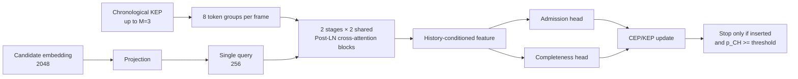

# ETA / DPD research module

This directory is an isolated research package for the ETA component described
in `SeaAgent_paper_10.10/main.tex`. It reads the SeaAgent trajectory memory and
Qwen vector index without changing application code outside `ETA/`.

The implementation separates four concerns:

1. `dataset/` builds source-grouped TEA samples and auditable proxy labels.
2. `training/` trains the paper-aligned model and structural ablations.
3. `evaluation/` measures accuracy, calibration, Stop behavior, and latency.
4. `research/` runs the complete ablation and capacity study and writes reports.

## Research boundary

The current database contains 214 tracks, 571 cached keyframes, and normalized
2048-dimensional pooled embeddings. It does not contain the paper's human AH/CH
annotations or raw visual tokens. The project therefore reports:

- proxy-label model behavior, never "human TEA accuracy";
- a pooled-vector token approximation, clearly separated from the paper design;
- actual counts and metrics from run artifacts, never placeholder paper values.

See [data_card.md](docs/data_card.md),
[labeling_protocol.md](docs/labeling_protocol.md), and
[paper_alignment.md](docs/paper_alignment.md) before interpreting results.

The completed proxy-label experiment is summarized in
[experimental_results.md](docs/experimental_results.md). The full model reached
AH `0.6805`, CH `0.7574`, joint accuracy `0.5325`, and batch-1 p50 latency
`0.435 ms`; these values describe the current data subset and are not the
paper's reported benchmark.

## Model



The KEP update is capacity-limited. A full pool replaces its lowest-priority
frame only when AH admits a higher-priority candidate. The model emits Stop only
when that insertion actually occurs and CH exceeds the configured threshold.

## Setup

The training environment requires Python 3.10+, PyTorch, NumPy, PyYAML,
Matplotlib, and FAISS. The server environment is already configured:

```bash
cd SeaAgent-v3.2-based_DA/ETA
export PYTHONPATH="$PWD/src"
python -m eta.cli build-data --config configs/default.yaml
```

Optional editable installation:

```bash
pip install -e . --no-deps
```

## Commands

Build TEA splits:

```bash
python -m eta.cli build-data --config configs/default.yaml
```

Train and evaluate one model:

```bash
python -m eta.cli train --config configs/default.yaml --run-name eta-main
python -m eta.cli evaluate --config configs/default.yaml \
  --run-dir artifacts/eta-main-...
```

Run both in one command:

```bash
python -m eta.cli run-all --config configs/smoke.yaml --run-name smoke
```

Run structural ablations and capacities:

```bash
python -m eta.cli research --config configs/default.yaml
```

Compare two independent evaluations without treating latency as reproducible:

```bash
python -m eta.cli compare --run-a artifacts/run-a --run-b artifacts/run-b \
  --tolerance 0.05
```

Use `--set key=value` for a reproducible override:

```bash
python -m eta.cli run-all --config configs/smoke.yaml \
  --set train.epochs=1 --run-name one-epoch
```

## Outputs

```text
ETA/
  configs/       default, smoke, structural and capacity configs
  src/eta/       installable experiment package
  tests/         unit and model-contract tests
  docs/          protocol, cards, alignment and integrity audit
  reports/       generated summaries and figures
  data/processed ignored TEA arrays and manifests
  artifacts/     ignored run directories and checkpoints
```

Each run contains `config.resolved.yaml`, `run.json`, `history.csv`, `best.pt`,
and `evaluation/`. The evaluation directory includes `metrics.json`,
`predictions.csv`, confusion matrices, calibration curves, and a Markdown
report.

## Verification

Run local tests:

```bash
python -m pytest -q
python -m ruff check .
python -m compileall -q src tests
```

Run GPU tests on the server:

```bash
PYTHONPATH=src python -m pytest -q
```

Model and document evidence is stored under `reports/`. Timing is hardware
dependent; accuracy intervals are finite-source-split uncertainty intervals,
not evidence that one architecture is universally superior.
